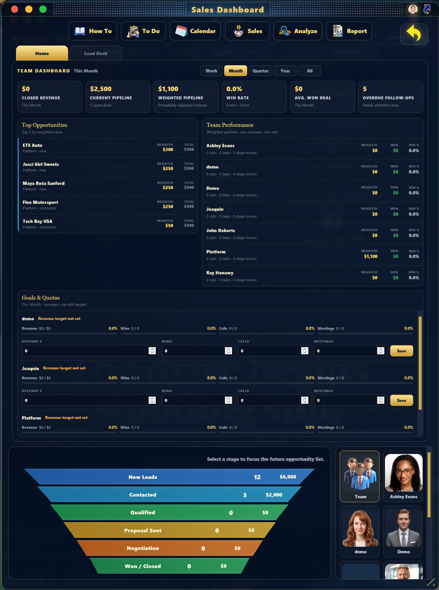

<div align="center">

# SSCRM
### Super Simple CRM

**A clean Java CRM focused on clarity, testing, and containerization.**

<br>


<br>

*Built for CEN 4802C — Continuous Integration, Testing, Packaging & Containerization*

</div>

---

<div align="center">

### Current Capabilities

</div>

| | Feature | Purpose |
|---|---------|---------|
| 📊 | **Customer & Revenue Intelligence** | High-level business overview |
| 🎯 | **Active Opportunities** | Live view of open deals |
| 💰 | **Pipeline Value** | Total value of the sales pipeline |
| ⚖️ | **Weighted Pipeline** | Probability-adjusted pipeline value |
| 📈 | **Average Active Deal** | Mean size of open opportunities |
| ⚡ | **Needs Action** | Owner-facing list of items requiring attention |
| 🔄 | **Sales Funnel** | Stage-based opportunity tracking |

<br>

> **Needs Action** surfaces the customers and opportunities that need attention *right now*.  
> Scoring is based on follow-up urgency, opportunity value, and funnel stage.

Each opportunity displays:
- Estimated value  
- Probability  
- Weighted value  
- Next follow-up date

---

<div align="center">

### Screenshot

<br>

<!-- Replace the link below with your actual screenshot -->



</div>

---

<div align="center">

### Project Structure

</div>

```text
src/main/java/
├── Main.java
├── Lead.java
├── CRMService.java
└── BusinessMetrics.java

src/test/java/
├── LeadTest.java
├── CRMServiceTest.java
├── BusinessMetricsTest.java
└── MainTest.java
