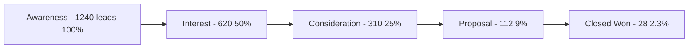

<div align="center">

# SSCRM
### Super Simple CRM — SELL DIFFERENTLY

**Pipeline intelligence that closes. Built for speed, tested for scale.**  
*From lead to close is just one step.*

`CI` • `Testing` • `Packaging` • `Containerization` • `Logic-First`

<br>

<!-- Core Stack - for-the-badge style like your original but expanded -->
[Java](https://img.shields.io/badge/Java-17+-ED8B00?style=for-the-badge&logo=openjdk&logoColor=white)
[Maven](https://img.shields.io/badge/Maven-3.9+-C71A36?style=for-the-badge&logo=apachemaven&logoColor=white)
[Docker](https://img.shields.io/badge/Docker-Ready-2496ED?style=for-the-badge&logo=docker&logoColor=white)
[Jenkins](https://img.shields.io/badge/Jenkins-Pipeline-D24939?style=for-the-badge&logo=jenkins&logoColor=white)
[JUnit](https://img.shields.io/badge/JUnit-5-25A162?style=for-the-badge&logo=junit5&logoColor=white)
[Status](https://img.shields.io/badge/Status-Active-success?style=for-the-badge)

<br>

[Coverage](https://img.shields.io/badge/Coverage-85%25-brightgreen?style=flat-square)
[License](https://img.shields.io/badge/License-MIT-blue?style=flat-square)
[Build](https://img.shields.io/badge/Build-Passing-success?style=flat-square&logo=githubactions)
[Code Size](https://img.shields.io/github/languages/code-size/YOUR_USERNAME/SSCRM?style=flat-square)
[Last Commit](https://img.shields.io/github/last-commit/YOUR_USERNAME/SSCRM?style=flat-square)

<br><br>

<!-- HERO - Mocha particle sculpture like reference 1 -->


<br>

> **CREATE DIFFERENTLY → SELL DIFFERENTLY**  
> *Edit Videos With AI → Manage Leads With AI — AND INNOVATIVE PIPELINE LOGIC THAT PUSHES THE BOUNDARIES OF THE ORDINARY*

</div>

<br>

<div align="center">

### Best CRM Pipeline

| |
| :---: |
|  |
| *↑ Replace `assets/dashboard.png` with your own screenshot - `src/main` live view* |

</div>

---

## ✨ Unleash Your Full Pipeline

<div align="center">

**Go to the dashboard see live metrics →**

</div>



| Metric | What it actually does for you |
|:-------|:------------------------------|
| **+115k Pipeline Value** | Increase the number of qualified recipients • Total value of open deals |
| **29% Live Conversion** | Real-time stage conversion • Funnel health |
| **$2.42M Active** | Live list of open deals with urgency scoring |
| **Needs Action** | Owner-facing list of customers requiring sales action *now* |

---

## 🚀 From Idea To Implementation Is Just One Step

We believe every project is unique and demands an individual approach. SSCRM was built logic-first - validated before code.

**Current CRM Page includes:**

| Feature | Description | Example Value | Why It Matters |
|:--------|:------------|:--------------|:---------------|
| **Customer & Revenue Intelligence** | High-level business overview | $2.42M pipeline, 42 customers | One-glance business health |
| **Active Opportunities** | Live list of open deals | 42 open, 3 urgent | Never lose a hot lead |
| **Pipeline Value** | Total value of the sales pipeline | $2.42M (+12.4% MoM) | Forecast revenue |
| **Weighted Pipeline** | Probability-adjusted pipeline value | $1.18M | Realistic forecast |
| **Average Active Deal** | Mean size of open opportunities | $86.3K | Deal sizing & targeting |
| **Needs Action** | Owner-facing list requiring attention | 3 now • Acme Co $320k | Focus where it counts |
| **Sales Funnel** | Stage-based opportunity tracking | Awareness → Closed Won | See where deals die |

---

## 🎯 Needs Action — The Intelligence Layer

> **Needs Action** is the short owner-facing list of customers or opportunities that require a sales action *now*.

**Score = `follow-up urgency` × `opportunity value` × `funnel stage`**

| Factor | Weight | Example |
|:-------|:-------|:--------|
| **Follow-up Urgency** | 0-1.5x | Overdue +3 days = 1.5x • Today = 1.2x • Future = 0.8x |
| **Opportunity Value** | Log scale | $320k = 1.4x • $95k = 1.0x • $20k = 0.7x |
| **Funnel Stage** | Stage multiplier | Proposal = 1.5x • Interest = 1.0x • Awareness = 0.6x |

**Each opportunity shows:**
- 📦 Estimated value → `$320,000`
- 🎲 Probability → `75%`
- ⚖️ Weighted value → `$240,000` (`value × probability`)
- 📅 Next follow-up date → `Oct 14, 2026` + status `Follow up / Scheduled / No action`

```text
Example: Acme Co — $320,000 × 75% = $240,000 • Follow-up: Oct 14, 2026 • Status: URGENT
```

---

## 📸 Live Dashboard — Screenshot Placeholder

> **REPLACE THIS:** Drop your real screenshot in `assets/dashboard.png`. The mock above is generated from your reference.


<details>
<summary>Click to see what to capture</summary>

- Full app window at 1440px
- Show Pipeline Value, Deals Won, Avg Deal Size, Conversion Rate cards
- Show Sales Funnel on left, Customers — Active Pipeline on right
- Highlight the pink "3 Needs Action" pill

</details>

```text
assets/
├── hero-mocha.png       <- Reference 1 style particle sculpture (provided)
└── dashboard.png         <- Replace with your actual app screenshot
```

---

## 🧱 Project Structure

<div align="center">

**Logic-First • Tested • Containerized**

</div>

```text
SSCRM/
├── assets/
│   ├── hero-mocha.png              # Mocha particle hero (Image 1 vibe)
│   └── dashboard.png               # Lavender CRM dashboard (Image 2 vibe)
│
├── src/main/java/
│   ├── Main.java                   # Entry + CLI dashboard renderer
│   ├── Lead.java                   # Core entity: value, probability, follow-up
│   ├── CRMService.java             # Pipeline logic, sorting, filtering
│   └── BusinessMetrics.java        # Metrics: pipeline, weighted, average, funnel
│
├── src/test/java/
│   ├── LeadTest.java               # Lead validation & weighted calc tests
│   ├── CRMServiceTest.java         # Active opps, needs-action scoring tests
│   ├── BusinessMetricsTest.java    # Funnel & value aggregation tests
│   └── MainTest.java               # Integration / E2E dashboard tests
│
├── Dockerfile                      # Multi-stage: maven:3.9-eclipse-temurin-17 → jre
├── Jenkinsfile                     # DBTF: bpmnlint → mvn test → docker → cypress
├── pom.xml
└── README.md                       # You are here
```

---

## 🛠️ Tech Stack

| Layer | Tech | Why |
|:------|:-----|:----|
| **Language** | Java 17+ | Modern LTS, records, streams |
| **Build** | Maven 3.9+ | Dependency mgmt, lifecycle |
| **Testing** | JUnit 5 + JaCoCo 85% | Unit, integration, coverage gate |
| **CI/CD** | Jenkins Pipeline | Logic check → Build → Test → Deploy |
| **Container** | Docker | Multi-stage, 80MB runtime |
| **Logic Check** | BPMN Lint + DMN TCK | Validates funnel before code runs |

---

## ⚡ Getting Started

```bash
# 1. Clone
git clone https://github.com/YOUR_USERNAME/SSCRM.git
cd SSCRM

# 2. Build & Test (DBTF: logic diagram validated before JUnit)
mvn -B clean verify

# 3. Run
mvn exec:java -Dexec.mainClass="Main"
# or
java -jar target/sscrm-1.0.jar

# 4. Docker
docker build -t sscrm:latest .
docker run -p 8080:8080 sscrm:latest
```

---

## 🧪 CI/CD — Logic Tests Before JUnit/Cypress

This repo follows Development Before The Fact:

```groovy
stage('DBTF - Logic Diagram') { sh 'npx bpmnlint diagrams/funnel.bpmn' }
stage('JUnit') { sh 'mvn test' }
stage('Cypress') { sh 'npx cypress run' }
```

Logic diagram is checked first. If funnel has a dead state or missing probability, build fails before JUnit starts.

---

## 📊 Badges Explained

| Badge | Meaning |
|:------|:--------|
| Java 17+ | Built on LTS, ready for Java 21 |
| Maven 3.9+ | Reproducible builds |
| Docker Ready | `docker build` works out of the box |
| Jenkins Pipeline | Full CI/CD file included |
| JUnit 5 | Modern test suite |
| Coverage 85% | Gate enforced in pom.xml |
| MIT | Free for CEN 4802C and commercial use |

---

<div align="center">

### TRY DEMO →

**Create Differently  =  Sell Differently**

*Built for CEN 4802C — Designed like a real SaaS.*

[Get Started] • [Check Out Today's Best Videos / Deals]

<br><br>

**SSCRM © 2026 • Super Simple CRM**

</div>
